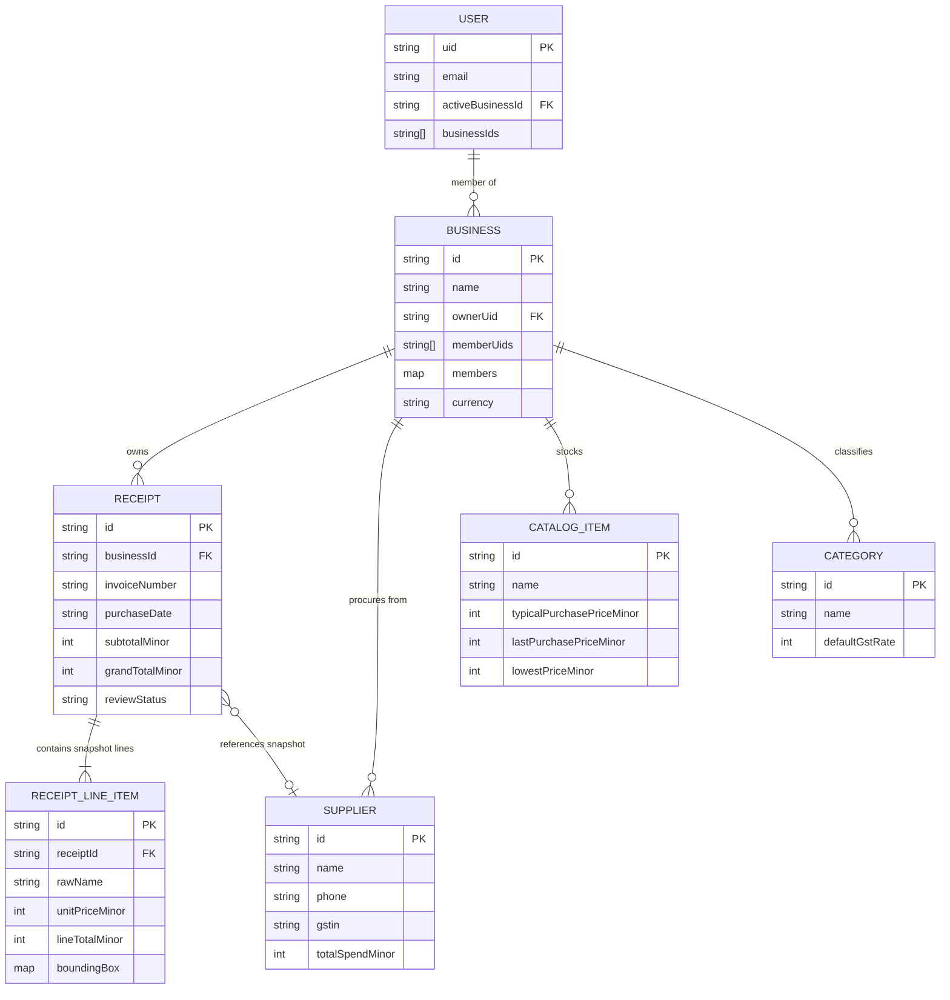

# ShopLedger Data Model & Secure Firebase Database Architecture

This document describes the business-scoped Firestore schema, subcollection hierarchy, integer minor currency calculations, security rules, composite indexes, and backend authorization contracts for ShopLedger.

---

## 1. Architectural Strategy & Design Principles

### 1.1 Business-Scoped Root Partitioning
Every merchant resource is scoped under a dedicated business entity root:
`/businesses/{businessId}`.

```
/users/{uid}                                    (User profile, active business pointer)
/businesses/{businessId}                        (Shop profile, legal info, team membership)
   ├── receipts/{receiptId}                     (Receipt header, totals, supplier, status)
   │     └── items/{lineItemId}                 (Receipt-specific historical line item snapshot)
   ├── suppliers/{supplierId}                   (Normalized supplier CRM & procurement stats)
   ├── items/{itemId}                           (Master SKU catalog & price trajectory)
   └── categories/{categoryId}                  (Category taxonomy & default GST slabs)
```

### 1.2 Snapshot Immutability for Audit Integrity
- When a receipt is extracted and verified, receipt-specific line items are saved into the `items/{lineItemId}` subcollection under the receipt.
- **Snapshot Principle:** The raw item name, unit price, quantity, discount, tax, and line total captured on that physical slip represent a permanent historical record.
- If the store later edits product details in `businesses/{businessId}/items/{itemId}` (e.g. changing the name from "Fortune Kachi Ghani 1L" to "Fortune Mustard Oil 1L Pouch" or updating the selling price), historical receipts remain completely unchanged.

### 1.3 Integer Minor Currency Units (Paise Strategy)
- In Indian retail and wholesale accounting, 1 Rupee (₹) = 100 Paise.
- All monetary totals, unit rates, discounts, taxes, and round-offs are stored strictly as **non-negative integers** representing paise.
- **Why integer minor units?** Standard IEEE-754 binary floating-point numbers incur rounding drift (`0.1 + 0.2 === 0.30000000000000004`). Minor integer math is completely immune to float rounding errors.
- **Naming convention:** All financial fields are explicitly suffixed with `Minor` (e.g., `grandTotalMinor: 1425000` = ₹14,250.00).

---

## 2. Entity-Relationship Model



---

## 3. Detailed Collection Schemas

### 3.1 User Profile (`/users/{uid}`)
```typescript
export interface UserAccount {
  uid: string;
  email: string;
  displayName: string;
  phoneNumber?: string;
  photoURL?: string;
  activeBusinessId: string;
  businessIds: string[];
  createdAt: string; // ISO 8601
  updatedAt: string; // ISO 8601
}
```

### 3.2 Business / Shop Profile (`/businesses/{businessId}`)
```typescript
export interface BusinessMember {
  uid: string;
  role: 'owner' | 'manager' | 'accountant' | 'cashier' | 'viewer';
  displayName: string;
  email: string;
  addedAt: string;
  addedBy: string;
}

export interface Business {
  id: string;
  name: string;                               // e.g. "Sharma Kirana Store"
  legalName?: string;
  businessType: 'kirana' | 'retail' | 'wholesale_mandi' | 'godown_warehouse' | 'general_store' | 'other';
  gstin?: string;                             // 15-character Indian GSTIN
  pan?: string;
  ownerUid: string;
  memberUids: string[];                       // Flat array for fast array-contains security queries
  members: Record<string, BusinessMember>;    // Detailed role map keyed by UID
  currency: 'INR';
  currencySymbol: '₹';
  address: {
    line1: string;
    line2?: string;
    city: string;
    state: string;
    pincode: string;
    country: 'IN';
  };
  phone?: string;
  email?: string;
  settings: {
    defaultTaxSlabs: number[];                // [0, 5, 12, 18, 28]
    confidenceThreshold: number;              // e.g. 0.85
    requireReviewForUncertain: boolean;
    dailyReconciliationReminder: boolean;
    language: 'en' | 'hi' | 'hinglish';
  };
  createdAt: string;
  updatedAt: string;
}
```

### 3.3 Purchase Receipt Header (`/businesses/{businessId}/receipts/{receiptId}`)
```typescript
export interface Receipt {
  id: string;
  businessId: string;
  invoiceNumber?: string;
  receiptDate: string;                        // YYYY-MM-DD
  purchaseDate: string;                       // YYYY-MM-DD
  supplier: {
    id?: string;
    name: string;
    phone?: string;
    gstin?: string;
    address?: string;
  };
  payment: {
    method: 'cash' | 'upi' | 'credit_udhar' | 'bank_transfer' | 'cheque';
    status: 'paid' | 'unpaid_udhar' | 'partially_paid';
    dueDate?: string;
    paidAmountMinor?: number;
    transactionRef?: string;
  };
  currency: 'INR';

  // Integer Minor Currency (Paise)
  subtotalMinor: number;
  taxTotalMinor: number;
  discountTotalMinor: number;
  roundOffMinor: number;
  grandTotalMinor: number;

  reviewStatus: 'draft' | 'processing' | 'needs_review' | 'verified' | 'reconciled' | 'archived';
  imagePath: string;                          // Cloud Storage path: businesses/{businessId}/receipts/{receiptId}/original.jpg
  thumbnailPath?: string;
  lineItemCount: number;

  extractionMetadata?: {
    model: string;                            // "gemini-2.5-flash"
    durationMs: number;
    overallConfidence: number;                // 0.0 to 1.0
    rawSnippet?: string;
    flaggedFieldsCount: number;
    errorReason?: string;
  };

  notes?: string;
  tags: string[];
  isDeleted: boolean;

  createdAt: string;
  updatedAt: string;
  confirmedAt?: string;
  confirmedBy?: string;
  reconciledAt?: string;
  deletedAt?: string;
}
```

### 3.4 Receipt Line Item Snapshot (`/businesses/{businessId}/receipts/{receiptId}/items/{lineItemId}`)
```typescript
export interface ReceiptLineItem {
  id: string;
  receiptId: string;
  businessId: string;
  lineIndex: number;

  // Permanent historical snapshot fields
  rawName: string;                            // e.g. "Fortune Kachi Ghani 1L Pouch"
  normalizedItemId?: string;                  // Optional link to catalog item
  category: string;                           // e.g. "Edible Oils & Ghee"
  hsnCode?: string;

  quantity: number;
  unit: 'kg' | 'gram' | 'pouch' | 'packet' | 'bag' | 'tin' | 'box' | 'carton' | 'liter' | 'ml' | 'piece' | 'bundle' | 'other';
  unitPriceMinor: number;                     // Integer paise
  discountMinor: number;                      // Integer paise
  taxRatePercent: number;                     // e.g. 5
  taxAmountMinor: number;                     // Integer paise
  lineTotalMinor: number;                     // Integer paise

  confidenceScore: number;                    // 0.0 to 1.0
  needsReview: boolean;
  reviewReason?: string;
  boundingBox?: {
    ymin: number;                             // 0..1000
    xmin: number;                             // 0..1000
    ymax: number;                             // 0..1000
    xmax: number;                             // 0..1000
  };

  createdAt: string;
  updatedAt: string;
}
```

### 3.5 Suppliers & Master Catalog
- `suppliers/{supplierId}`: Tracks vendor contacts, GSTIN, payment terms, historical total spend, and purchase frequency.
- `items/{itemId}`: Master SKU directory keeping track of historical purchase price points (`lowestPriceMinor`, `lastPurchasePriceMinor`, `typicalPurchasePriceMinor`).
- `categories/{categoryId}`: Master taxonomy for grouping items into Kirana sections with default GST slabs.

---

## 4. Security Rules Architecture

### 4.1 Firestore Security (`firestore.rules`)
- **Default Deny-All:** Root matches reject all operations unless explicitly permitted.
- **Tenant Isolation:** All subcollections (`receipts`, `items`, `suppliers`, `categories`) check `isBusinessMember(businessId)`.
- **Membership Verification:** Checks if `request.auth.uid` is contained in `resource.data.memberUids` or `resource.data.members[uid]`.
- **Schema & Type Enforcement:** Financial fields (`subtotalMinor`, `grandTotalMinor`, `unitPriceMinor`, `lineTotalMinor`) are strictly validated as `is int` and `>= 0`.
- **Role Permissions:**
  - Owner: Full access (delete business, update settings, delete receipts).
  - Editor (Manager, Accountant): Read & write receipts, line items, and catalog.
  - Cashier / Viewer: Read-only access to verify entries.

### 4.2 Storage Security (`storage.rules`)
- Scoped strictly to `/businesses/{businessId}/receipts/{receiptId}/{fileName}`.
- Reads verified via cross-service Firestore lookup `firestore.get(...)` against the business document.
- Write constraints:
  - Max upload size: 15MB (`15 * 1024 * 1024` bytes).
  - Supported MIME types: `image/(jpeg|png|webp|heic)|application/pdf`.

### 4.3 Backend Firebase Admin SDK Responsibility
> [!IMPORTANT]
> The Firebase Admin SDK in the Express.js backend **bypasses Firestore Security Rules**. Backend services must explicitly verify:
> 1. That the authenticated JWT token matches a valid Firebase user (`admin.auth().verifyIdToken`).
> 2. That `decodedToken.uid` has membership in the requested `businessId` before executing any query or mutation.
> 3. That client-supplied IDs in request bodies or query params are validated against the tenant ID.

---

## 5. Composite Query Indexes (`firestore.indexes.json`)

The following compound indexes are provisioned to serve high-performance querying without table scans:

| Collection | Indexed Fields | Purpose |
|---|---|---|
| `receipts` | `isDeleted` ASC, `purchaseDate` DESC | Default active receipts ledger listing |
| `receipts` | `reviewStatus` ASC, `purchaseDate` DESC | Filtering by status ("Needs Review", "Verified") |
| `receipts` | `isDeleted` ASC, `reviewStatus` ASC, `purchaseDate` DESC | Filtered active ledger view |
| `receipts` | `supplier.id` ASC, `purchaseDate` DESC | Vendor-specific invoice history |
| `receipts` | `payment.status` ASC, `purchaseDate` DESC | Udhar (unpaid/partial) credit tracking |
| `items` | `category` ASC, `name` ASC | Catalog browsing & alphabetic sorting |
| `items` | `lastPurchaseDate` DESC | Recently procured inventory |
| `suppliers` | `totalSpendMinor` DESC | Top procurement partners ranking |
| `suppliers` | `lastPurchaseDate` DESC | Active supplier relationship tracking |

---

## 6. Automated Verification

Automated test suites verify arithmetic safety, schema constraints, and security rule semantics:
```bash
# Run all tests
pnpm test

# Run individual test suites
pnpm test:money     # Validates integer minor arithmetic, Lakhs/Crores formatting, and float safety
pnpm test:schema    # Validates Zod schema constraints, GSTIN patterns, and bounding box 0..1000
pnpm test:rules     # Audits firestore.rules and storage.rules for default deny, isolation, and 15MB limits
```
All 22 test assertions pass cleanly with zero warnings.
