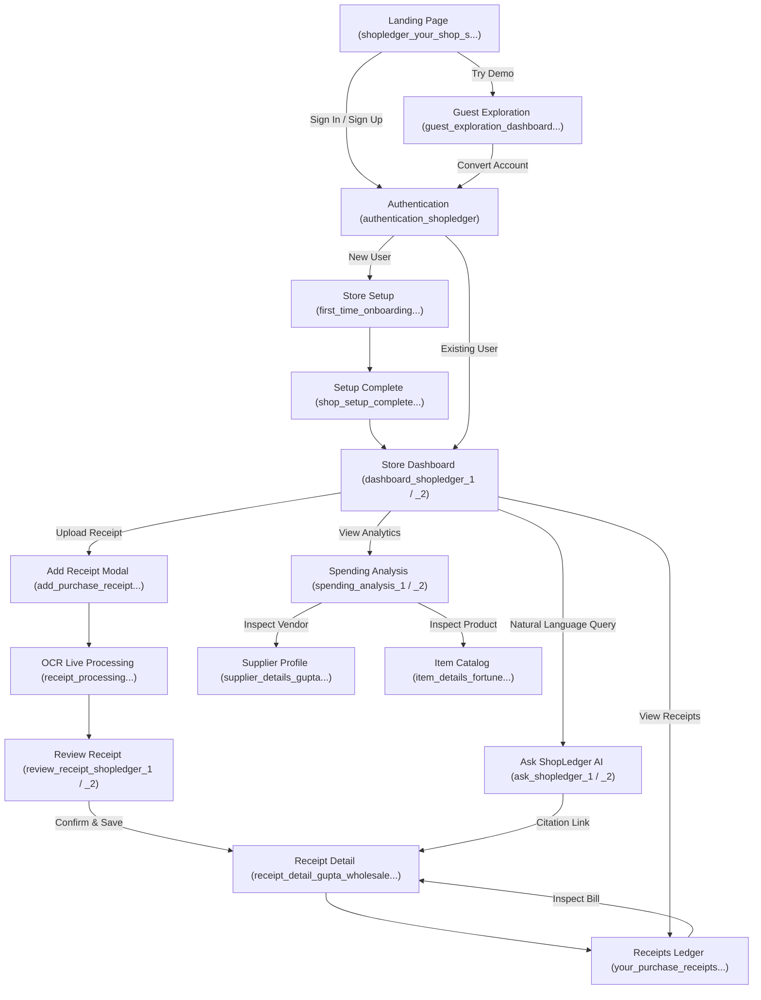

# ShopLedger Design Reference Inventory & Stitch Analysis

## 1. Executive Summary & Inventory Overview

This document presents a comprehensive audit of all Stitch design exports and references found in the ShopLedger repository. ShopLedger is an enterprise-grade, Kirana-first receipt management, optical character recognition (OCR) reconciliation, and spending analytics platform tailored for Indian retail, wholesale, and mandi merchants.

All design assets reside in the `designs/` directory. No assumptions were made regarding pre-existing file names or structures; every item recorded below reflects the exact filenames, resolutions, code implementations, and interaction specifications extracted directly from disk.

### Global Summary Statistics
- **Total Design Reference Folders:** 20 directories
- **Screen HTML Prototypes (`code.html`):** 19 interactive HTML prototypes
- **Design Mockup Screenshots (`screen.png`):** 19 high-resolution raster renders
- **Core Design System Specifications (`DESIGN.md`):** 1 central design token specification file (`designs/shopledger/DESIGN.md`)
- **Foundational Typography:** Inter (with tabular figures `font-feature-settings: "tnum" 1, "cv05" 1`)
- **Primary Color Language:** Warm Ivory (`#FAF9F4`) canvas, Crisp White (`#FFFFFF`) cards, Deep Forest Green (`#245C45` / `#04442f`) brand actions, Amber (`#D97706` / `#FEF3C7`) low-confidence checking indicators.

---

## 2. Complete Design Reference Inventory

Below is the verified inventory of all 19 screen designs, recorded with exact directory paths, filenames, image dimensions, aspect ratios, responsive form factors, and primary user-facing functions.

| # | Folder Name | Image Path | Code Path | Dimensions (W × H) | Aspect Ratio | Form Factor | Theme Variant | Primary Purpose / Feature |
|---|---|---|---|---|---|---|---|---|
| 1 | `add_purchase_receipt_shopledger` | `designs/add_purchase_receipt_shopledger/screen.png` | `designs/add_purchase_receipt_shopledger/code.html` | 1600 × 1312 | 1.22:1 | Desktop / Tablet (Modal) | Light | Bill ingestion hub: camera capture, file upload dropzone, manual bill creation fallback, and camera permission error guide |
| 2 | `ask_shopledger_shopledger_1` | `designs/ask_shopledger_shopledger_1/screen.png` | `designs/ask_shopledger_shopledger_1/code.html` | 1388 × 1600 | 0.87:1 | Desktop / Tablet | Light | AI Assistant empty/welcome state: prompt library, tips for scanning faded Mandi slips, query suggestions |
| 3 | `ask_shopledger_shopledger_2` | `designs/ask_shopledger_shopledger_2/screen.png` | `designs/ask_shopledger_shopledger_2/code.html` | 1600 × 1280 | 1.25:1 | Desktop (Split view) | Light | AI Assistant conversational response: multi-supplier price comparison cards, source receipt citation chips, interactive charts |
| 4 | `authentication_shopledger` | `designs/authentication_shopledger/screen.png` | `designs/authentication_shopledger/code.html` | 1600 × 1152 | 1.39:1 | Desktop / Mobile Centered | Light / Dark Toggle | Split sign-in & sign-up modal, Google OAuth, phone/email login, 1-click guest exploration entry, FAQ drawer |
| 5 | `dashboard_shopledger_1` | `designs/dashboard_shopledger_1/screen.png` | `designs/dashboard_shopledger_1/code.html` | 1259 × 1600 | 0.79:1 | Desktop (12-Col) | Light | Main Kirana Dashboard: 4 key KPI stats, Recent Purchase Receipts table, Night Reconciliation Helper widget, Top Vendors list |
| 6 | `dashboard_shopledger_2` | `designs/dashboard_shopledger_2/screen.png` | `designs/dashboard_shopledger_2/code.html` | 744 × 1600 | 0.46:1 | Responsive / Tablet / Mobile | Light | Extended Dashboard: Multi-branch switcher, Unclaimed bill alert banner, 5-col Category spend breakdown, Top 10 procurement rank |
| 7 | `first_time_onboarding_shopledger` | `designs/first_time_onboarding_shopledger/screen.png` | `designs/first_time_onboarding_shopledger/code.html` | 1068 × 1600 | 0.67:1 | Desktop / Tablet Centered | Light | 3-Step Store Setup Wizard: Shop name input, selectable business type cards (Kirana, Retail, Mandi, Warehouse, Other), Language & Currency selection |
| 8 | `guest_exploration_dashboard_shopledger` | `designs/guest_exploration_dashboard_shopledger/screen.png` | `designs/guest_exploration_dashboard_shopledger/code.html` | 953 × 1600 | 0.60:1 | Desktop / Tablet | Light | Sandbox Demo Mode: Persistent demo banner, sample kirana dataset ("Aggarwal General Store"), 4-step interactive guided tour, registration conversion trigger |
| 9 | `item_details_fortune_kachi_ghani_mustard_oil_shopledger` | `designs/item_details_fortune_kachi_ghani_mustard_oil_shopledger/screen.png` | `designs/item_details_fortune_kachi_ghani_mustard_oil_shopledger/code.html` | 985 × 1600 | 0.62:1 | Desktop / Responsive | Light | Master SKU / Item Catalog record: purchase history across vendors, rate changes per liter, unit pack sizes, edit catalog modal |
| 10 | `receipt_detail_gupta_wholesale_mart_shopledger` | `designs/receipt_detail_gupta_wholesale_mart_shopledger/screen.png` | `designs/receipt_detail_gupta_wholesale_mart_shopledger/code.html` | 1066 × 1600 | 0.67:1 | Desktop (Split view) | Light | Saved voucher inspector: high-res scan viewer (#GW-8941), line-item ledger, GST tax slab reconciliation, AI extraction confidence audit log |
| 11 | `receipt_processing_shopledger` | `designs/receipt_processing_shopledger/screen.png` | `designs/receipt_processing_shopledger/code.html` | 1252 × 1600 | 0.78:1 | Desktop / Tablet Centered | Light | Live OCR Ingestion Tracker: animated 4-stage pipeline (Voucher Uploaded -> Vision Analysis -> Tax & Line Extraction -> Integrity Verification) |
| 12 | `review_receipt_shopledger_1` | `designs/review_receipt_shopledger_1/screen.png` | `designs/review_receipt_shopledger_1/code.html` | 1394 × 1600 | 0.87:1 | Desktop (5:7 Split) | Light + Dark styling | Verification Workspace: Left voucher viewer with interactive zoom/rotate; right bill header & editable line items table with "Needs checking" amber highlights |
| 13 | `review_receipt_shopledger_2` | `designs/review_receipt_shopledger_2/screen.png` | `designs/review_receipt_shopledger_2/code.html` | 1363 × 1600 | 0.85:1 | Desktop (5:7 Split) | Light | Verification Workspace Variant: Enhanced confidence scoring alert banner, subtotal math discrepancy check, sticky "Confirm & save to Bahi Khata" footer |
| 14 | `shopledger_your_shop_s_records_finally_in_order` | `designs/shopledger_your_shop_s_records_finally_in_order/screen.png` | `designs/shopledger_your_shop_s_records_finally_in_order/code.html` | 460 × 1600 | 0.29:1 | Full Page Landing (Marketing) | Light | Product Landing Page: Hero, value proposition for Indian shopkeepers, Before/After Bahi Khata comparison, feature highlights, FAQs, CTA |
| 15 | `shop_setup_complete_shopledger` | `designs/shop_setup_complete_shopledger/screen.png` | `designs/shop_setup_complete_shopledger/code.html` | 1364 × 1600 | 0.85:1 | Desktop Centered Card | Light | Setup Success / Handoff Screen: "Gemini AI OCR & Price Tracker Armed", GST defaults, 3-step usage primer, CTA to upload first bill or open dashboard |
| 16 | `spending_analysis_shopledger_1` | `designs/spending_analysis_shopledger_1/screen.png` | `designs/spending_analysis_shopledger_1/code.html` | 585 × 1600 | 0.37:1 | Desktop / Tablet Longform | Light | Comprehensive Spending Analytics: Shop insights, monthly spending chart, top suppliers by spend, category breakdown, Mandi rate price tracker |
| 17 | `spending_analysis_shopledger_2` | `designs/spending_analysis_shopledger_2/screen.png` | `designs/spending_analysis_shopledger_2/code.html` | 1140 × 1600 | 0.71:1 | Desktop Executive View | Light | High-density Spending Dashboard: "Where Did Your Money Go?", wholesale vendor volume rankings, price inflation alert cards |
| 18 | `supplier_details_gupta_wholesale_mart_shopledger` | `designs/supplier_details_gupta_wholesale_mart_shopledger/screen.png` | `designs/supplier_details_gupta_wholesale_mart_shopledger/code.html` | 1077 × 1600 | 0.67:1 | Desktop (12-Col) | Light | Supplier CRM / Profile: Monthly procurement trends, historical invoices ledger, top sourced items, aliases/phone/GSTIN, shopkeeper notes |
| 19 | `your_purchase_receipts_shopledger` | `designs/your_purchase_receipts_shopledger/screen.png` | `designs/your_purchase_receipts_shopledger/code.html` | 1278 × 1600 | 0.80:1 | Desktop Ledger View | Light | Master Purchase Receipts Ledger: Tabbed status filters (All, Needs Checking, Verified), search bar, date range picker, tabular data grid, empty states |
| 20 | `shopledger` (Folder) | N/A | `designs/shopledger/DESIGN.md` | N/A | N/A | Design Tokens / Spec | Universal | Source of truth design tokens: CSS colors, typography scale, border radius, spacing units, elevation, content vocabulary |

---

## 3. Screen-by-Screen Deep Dive & Visual Analysis

### 3.1 Landing & Marketing Experience
- **Folder:** `shopledger_your_shop_s_records_finally_in_order`
- **Component File Target:** `frontend/src/pages/LandingPage.tsx`
- **Key Visual Elements:**
  - Hero banner with badge: `"Made for Indian Kirana & Wholesale Stores"`.
  - Headline: *"Your shop's purchase records, finally in order."*
  - Problem/Solution comparative visual: *"Before ShopLedger"* (crumpled slips, lost invoices, unnoticed price hikes) vs. *"After ShopLedger"* (instant OCR scan, verified ledger, vendor price tracking).
  - Use-case segments: Kirana & General Stores, Mandi Traders, Multi-store Retailers & Godowns.
  - Call to Action (CTA) buttons: `"Explore Live Demo (No sign up)"` and `"Create Shop Account"`.

### 3.2 Authentication & Guest Mode Entry
- **Folder:** `authentication_shopledger`
- **Component File Target:** `frontend/src/pages/AuthPage.tsx`
- **Key Visual Elements:**
  - Dual Tab switcher: `"Sign in to your store"` / `"Create new shop"`.
  - Social Auth: Google Sign-in button with official branding.
  - Form Fields: Shop Name, Business Type select, Phone/Email, Password with visibility toggle.
  - Guest Exploration Card: `"Curious how it works first? Try ShopLedger in 1-Click Guest Mode with pre-loaded Kirana demo data"`.
  - Floating Help & Guidance drawer: explanations for privacy, GST requirement exemptions, and camera access.
  - **Theme Support:** Prototype includes working Light / Dark mode toggle with class-based switches (`dark:bg-[#161815]`, `dark:border-[#2E362C]`).

### 3.3 Shop Onboarding & First-Time Setup
- **Folders:** `first_time_onboarding_shopledger` & `shop_setup_complete_shopledger`
- **Component File Targets:** `frontend/src/pages/OnboardingPage.tsx` & `frontend/src/pages/SetupCompletePage.tsx`
- **Key Visual Elements:**
  - 3-Step Progress Indicator in top header: `1. Store Details` -> `2. GST & Categories` -> `3. First Bill`.
  - Business Type selection grid with interactive cards:
    1. *Kirana / Grocery Store* (Pre-selected default)
    2. *Retail Shop (Clothing, Hardware, Chemist)*
    3. *Wholesale / Mandi Trader*
    4. *Warehouse / Godown*
    5. *Other Business*
  - Language selection: English, Hindi (`हिन्दी`), Hinglish, Gujarati, Marathi.
  - Setup Complete Screen: Celebration badge `"Gemini AI OCR & Price Tracker Armed"`, verification summary, action trigger `"Snap or upload your first bill"`.

### 3.4 Main Store Dashboard (Desktop & Responsive Variants)
- **Folders:** `dashboard_shopledger_1` (Desktop 12-col) & `dashboard_shopledger_2` (Extended / Responsive)
- **Component File Target:** `frontend/src/pages/DashboardPage.tsx`
- **Key Visual Elements:**
  - Greeting Header: `"Namaste Ramesh ji 👋 • Sharma Kirana Store (Main Bazar)"`.
  - Metric Summary Strip (4 KPI Cards):
    1. *Money spent this month*: Tabular currency `₹1,48,650` with month-over-month trend.
    2. *Total Invoices*: `34 bills recorded`.
    3. *Needs checking (Low Confidence)*: Amber alert pill `2 bills need review`.
    4. *Verified Bills*: Green pill `32 bills cleared`.
  - Branch & Time Filter: Dropdown for multi-outlet management (`Main Bazar Store`, `Godown #2`) and date intervals (`October 2024`, `Last 30 Days`).
  - Unclaimed / Needs Review Alert Ribbon: Direct CTA to jump into pending voucher verification.
  - 5-Column Category Spend Grid: Groceries & Grains, Edible Oils & Ghee, Spices & Masalas, Dairy & Beverages, Personal & Cleaning.
  - Recent Purchase Receipts Table: Columns for Invoice ID, Supplier, Date, Category pill, Amount, Status badge (`Needs checking` vs `Verified`), and Actions.
  - Daily Night Reconciliation Helper Card: Dedicated evening checklist for shopkeepers to tally cash vs credit slips before shuttering shop.

### 3.5 Guest Exploration Mode
- **Folder:** `guest_exploration_dashboard_shopledger`
- **Component File Target:** `frontend/src/pages/GuestDashboardPage.tsx`
- **Key Visual Elements:**
  - Persistent amber warning header: `"You are exploring ShopLedger with sample demo data — Create a free shop account to save your real bills."`
  - Demo store banner: `"Aggarwal General Store • Karol Bagh, New Delhi"`.
  - 4-Card Tour Pathway: 
    1. *Store Dashboard*
    2. *OCR Bill Inspector*
    3. *Margin & Price Spikes*
    4. *Ask ShopLedger AI*
  - Conversion Gates: Attempting to save new receipts or delete mock items opens a non-blocking modal offering 1-click Google Sign-in with demo data transfer.

### 3.6 Bill Upload & Ingestion
- **Folder:** `add_purchase_receipt_shopledger`
- **Component File Target:** `frontend/src/components/receipts/UploadReceiptModal.tsx`
- **Key Visual Elements:**
  - Three distinct input modalities:
    1. *Take a photo*: Live webcam / device camera viewfinder with edge detection guide.
    2. *Upload a photo / PDF*: Drag-and-drop dropzone supporting JPEG, PNG, WEBP, PDF up to 15MB.
    3. *Create manually*: Fallback direct ledger form when paper voucher is destroyed or verbal.
  - Kirana Zero-Risk Assurance badge: *"No blind ledger writes — You always review and confirm extracted line items before anything is saved."*
  - Error recovery helper accordion: Camera permissions denied, blurry image tips, file size limits, offline recovery.

### 3.7 Live OCR Processing Progress
- **Folder:** `receipt_processing_shopledger`
- **Component File Target:** `frontend/src/components/receipts/ReceiptProcessingState.tsx`
- **Key Visual Elements:**
  - Header: `"Reading your wholesale receipt…"` with animated pulse icon.
  - 4-Stage Extraction Pipeline Tracker:
    - Stage 1: *Voucher Uploaded* (File checksum & image enhancement)
    - Stage 2: *Gemini Vision Multimodal Analysis* (Layout & handwritten text detection)
    - Stage 3: *Tax & Line Item Parsing* (GST slabs, HSN codes, rate/qty breakdown)
    - Stage 4: *Ledger Cross-Check & Integrity Math* (Subtotal + Tax == Total)
  - Live key findings preview card (Supplier detected: "Gupta Wholesale Mart", Bill Date: "24 Oct 2024", Total: "₹18,450").

### 3.8 Split-Screen Receipt Review & Verification (Two Variants)
- **Folders:** `review_receipt_shopledger_1` & `review_receipt_shopledger_2`
- **Component File Target:** `frontend/src/pages/ReviewReceiptPage.tsx`
- **Key Visual Elements:**
  - Fixed 12-Column Split Layout:
    - **Left Panel (5 Columns):** High-resolution image canvas with zoom (+ / - / fit), rotate, pan, and bounding box visual overlays. Bounding boxes are color-coded (Green = high confidence, Yellow/Amber = needs checking).
    - **Right Panel (7 Columns):** Form & Line Items Editor.
  - Bill Header Fields: Bought From (Vendor autocompleted against supplier directory), Bill/Invoice Number, Bill Date, Payment Mode (Cash, UPI, Credit / *Udhar*).
  - Amber Review Warning: *"AI flagged 2 line items with low confidence. Please verify rate & quantity before saving."*
  - Extracted Items Data Table:
    - Item Name (e.g., `Fortune Kachi Ghani Mustard Oil 1L`)
    - Category tag
    - Quantity & Unit (`15 Pouch`, `25 Kg Bag`)
    - Purchase Rate / Unit Price (`₹142.00`)
    - Line Total (`₹2,130.00`)
    - Status pill (`Verified` emerald pill vs. `Needs checking` amber pill)
    - Inline edit and delete controls.
  - Tax Breakdown & Grand Total Verification: OCR Grand Total vs Calculated Sum comparison. Red alert triggers if line items + taxes do not equal grand total.
  - Sticky Footer Actions: `Add manual line`, `Discard bill`, `Save as Draft`, `Confirm & save to Bahi Khata`.

### 3.9 Master Receipts Ledger
- **Folder:** `your_purchase_receipts_shopledger`
- **Component File Target:** `frontend/src/pages/ReceiptsPage.tsx`
- **Key Visual Elements:**
  - Status Filter Tabs: `All Receipts (34)`, `Needs Checking (2)`, `Verified (32)`, `Drafts (0)`.
  - Search & Filter Bar: Instant search across supplier names, item descriptions, and invoice numbers. Date range quick selector (`This Month`, `September 2024`, `Custom`).
  - Data Grid Columns: Receipt / Bill ID, Supplier & Mandi, Bill Date, Items & Category count, Total Amount, Verification Status, Scanned Timestamp, Action menu.
  - Filter empty state: Friendly illustration with button to clear filters.

### 3.10 Saved Receipt Detail View
- **Folder:** `receipt_detail_gupta_wholesale_mart_shopledger`
- **Component File Target:** `frontend/src/pages/ReceiptDetailPage.tsx`
- **Key Visual Elements:**
  - View-only dual pane showing original scan (#GW-8941) alongside verified ledger entry.
  - GST Slab Reconciliation box: Breakdown across 0%, 5%, 12%, 18% CGST/SGST.
  - Audit Trail & AI Extraction Log: Timestamp of scan, Gemini model version, verification timestamp, operator name ("Ramesh Sharma").
  - Supplier Price Intelligence card: Comparison showing whether prices on this invoice were higher or lower than the previous invoice from this vendor.

### 3.11 Spending Analysis & Price Intelligence (Two Variants)
- **Folders:** `spending_analysis_shopledger_1` (Detailed) & `spending_analysis_shopledger_2` (Executive)
- **Component File Target:** `frontend/src/pages/SpendingAnalysisPage.tsx`
- **Key Visual Elements:**
  - Actionable Kirana Insight Cards:
    - *"You bought cooking oil from 4 different suppliers this month"* (Consolidation opportunity).
    - *"Sugar (M-30 Grade) purchase price increased by ₹2.40/kg since 12 Oct"*.
    - *"Most of your recorded spending was in Grains & Pulses (35.2%)"*.
  - Monthly Spend Trajectory Chart (Interactive bar/area visualization).
  - Supplier Share Breakdown: Donut/Progress distribution across Gupta Wholesale, Shree Balaji, etc.
  - Mandi vs. Brand Wholesale Price Tracker: Price curve over 6 months for key commodities (Edible oil, wheat flour, basmati rice, sugar).

### 3.12 Supplier CRM & Ledger Profile
- **Folder:** `supplier_details_gupta_wholesale_mart_shopledger`
- **Component File Target:** `frontend/src/pages/SupplierDetailPage.tsx`
- **Key Visual Elements:**
  - Header: Vendor Name (`Gupta Wholesale Mart`), Mandi / Market location, GSTIN, Phone, Contact Person.
  - Monthly procurement volume chart (`₹84,200 in October`).
  - Purchase Receipts History table filtered to this supplier.
  - Top Sourced Items list with latest purchase rates.
  - Private Shopkeeper Notes & Vendor Aliases (e.g. `Gupta Ji Mandi Wale`, `Invoice name: GWM Provisions`).
  - Edit supplier profile modal.

### 3.13 Item Catalog & Rate Tracker
- **Folder:** `item_details_fortune_kachi_ghani_mustard_oil_shopledger`
- **Component File Target:** `frontend/src/pages/ItemDetailPage.tsx`
- **Key Visual Elements:**
  - Master Item Header: SKU name (`Fortune Kachi Ghani Mustard Oil 1L Pouch`), primary category, default unit.
  - Purchase Rate History across all suppliers: Table and line chart showing fluctuations from ₹138 to ₹146 per liter over the past 90 days.
  - Sourcing breakdown: Percentage bought from Gupta Wholesale vs Shree Balaji Traders.
  - Edit catalog item drawer: Adjust normalized item name, barcode/HSN code, reorder trigger alerts.

### 3.14 Ask ShopLedger (Natural Language Assistant - Two States)
- **Folders:** `ask_shopledger_shopledger_1` (Empty/Welcome) & `ask_shopledger_shopledger_2` (Active Conversation)
- **Component File Target:** `frontend/src/pages/AskShopLedgerPage.tsx`
- **Key Visual Elements:**
  - Welcome State (`_1`):
    - Greeting: *"Namaste Ramesh ji. Ask anything about your shop's purchase bills, prices, or suppliers."*
    - Prompt Library chips: *"Who gave me the best rate for Basmati rice this month?"*, *"How much did I spend with Balaji Traders?"*, *"List all bills pending verification"*.
    - Data scope banner: Confirms that queries only inspect verified receipts belonging to this shop.
  - Active Response State (`_2`):
    - Multi-turn conversational interface.
    - Rich UI Response Cards: Not just plain text, but interactive supplier rate comparison cards (`Gupta Wholesale Mart ₹142.00/L` vs `Shree Balaji Traders ₹148.50/L`).
    - Direct receipt citations: Clicking a citation chip opens the exact receipt scan in the split-view inspector.

---

## 4. User Journey & Screen Relationship Architecture

The Stitch screens interlock into 5 core business journeys:



---

## 5. Derived Shared Design System (Stitch Source of Truth)

All styles, tokens, and components are derived directly from `designs/shopledger/DESIGN.md` and the 19 HTML mockups.

### 5.1 Color Palette
- **Canvas / Background:** `#FAF9F4` (Warm Ivory light mode), `#161815` (Deep Basalt dark mode).
- **Cards & Surfaces:** `#FFFFFF` (Crisp White), `#F5F4EF` (Surface Container Low), `#EFEEE9` (Surface Container), `#E3E3DE` (Surface Container Highest).
- **Primary Brand (Action / Growth):** `#245C45` (Forest Green Container), `#04442f` (Deep Forest Green hover), `#99D2B5` (On Primary Container).
- **Secondary (Neutral Badges & Tabs):** `#57615B` (Secondary text), `#DBE5DD` (Sage Container), `#5D6760` (On Secondary Container).
- **Feedback & OCR Review Status:**
  - *Needs Checking (Low Confidence / Flagged):* Background `#FEF3C7`, Text `#D97706`, Border `#FCD34D`.
  - *Verified / Cleared:* Background `#DCFCE7`, Text `#15803D`, Border `#86EFAC`.
  - *Error / Math Mismatch:* Background `#FEE2E2`, Text `#DC2626`, Border `#FCA5A5`.
- **Text & Contrast:** Primary text `#1B1C19` (High contrast charcoal), Secondary label `#404943`, Muted timestamps `#707973`.

### 5.2 Typography System
- **Font Family:** `Inter, -apple-system, BlinkMacSystemFont, "Segoe UI", Roboto, sans-serif`.
- **Tabular Figures Requirement:** All currencies, unit rates, quantities, and totals MUST apply:
  ```css
  font-feature-settings: "tnum" 1, "cv05" 1;
  font-variant-numeric: tabular-nums;
  ```
- **Scale:**
  - `display`: 2.25rem (36px), 700 weight, line height 2.75rem.
  - `headline-lg`: 1.5rem (24px), 700 weight, line height 2.0rem.
  - `headline-sm`: 1.25rem (20px), 600 weight, line height 1.75rem.
  - `currency-stat`: 1.75rem (28px), 700 weight, tabular figures.
  - `body-lg`: 1.0rem (16px), 400 weight, line height 1.5rem.
  - `body-sm`: 0.875rem (14px), 400 weight, line height 1.25rem.
  - `label-md`: 0.875rem (14px), 600 weight, line height 1.25rem.
  - `label-xs`: 0.75rem (12px), 600 weight, letter spacing 0.02em.

### 5.3 Indian Retail & Kirana Vocabulary Rules
The application strictly avoids Western enterprise accounting jargon:
- Use **"Money spent"** instead of *Accounts Payable* or *Expenditure*.
- Use **"Bought from"** instead of *Vendor Entity* or *Creditor*.
- Use **"Needs checking"** instead of *Anomaly Detected* or *Low Confidence Flag*.
- Use **"Confirm & save to Bahi Khata"** instead of *Commit Transaction*.
- Use **"Mandi / Wholesale Slips"** instead of *Commercial Invoices*.

---

## 6. Identification of Missing & Ambiguous References

While the 19 Stitch references provide rich visual coverage for core features, the audit identified the following specific gaps that must be architected cleanly:

1. **Dedicated Settings & Shop Profile Page:**
   - *Current State:* The sidebar navigation links to `settings` and `help-and-faqs`, but no dedicated `settings_shopledger` folder exists in `designs/`.
   - *Resolution:* Derive `SettingsPage.tsx` directly from the established form inputs in `first_time_onboarding_shopledger` and `supplier_details_gupta_wholesale_mart_shopledger` (tax slabs, branch manager, export data, theme preferences).
2. **Help & FAQs Full Page:**
   - *Current State:* Help is shown as a floating drawer in `authentication_shopledger` and `add_purchase_receipt_shopledger`.
   - *Resolution:* Implement `HelpPage.tsx` using the drawer accordion styling and Kirana FAQ copy already present in those prototypes.
3. **Multi-Bill Batch Uploading:**
   - *Current State:* `add_purchase_receipt_shopledger` depicts single-slip capture. Kirana owners often scan 10-15 Mandi slips in one batch at night.
   - *Resolution:* Architect the backend ingestion pipeline and client dropzone to support sequential batch queuing without departing from the single-slip review UI.
4. **Offline Sync Status & Network Dropout Indicator:**
   - *Current State:* Error copy in `add_purchase_receipt_shopledger` notes *"Internet connection dropped"*, but does not specify a persistent offline banner.
   - *Resolution:* Add a discreet offline sync pill to the application header.
