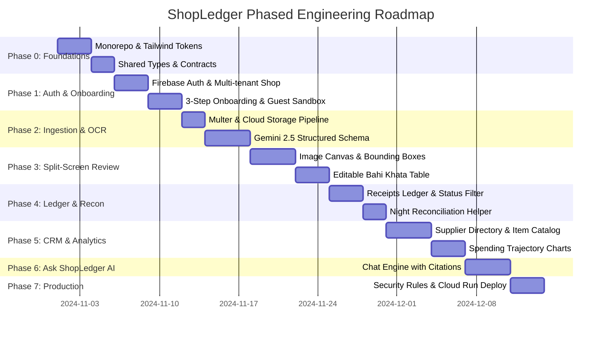

# ShopLedger Implementation Roadmap & Execution Strategy

## 1. Executive Implementation Roadmap

This roadmap establishes a disciplined, phased engineering plan to implement ShopLedger from the audited Stitch design source of truth into a production-grade web application. Every milestone adheres strictly to the architectural constraints: a clean `frontend/` and `backend/` monorepo, strict backend encapsulation of Gemini API calls, multi-tenant Firestore isolation, and faithful replication of the 19 Stitch screen designs.

---

## 2. Phase-by-Phase Execution Milestones

### Phase 0: Monorepo Setup, Tooling & Design System Foundations
- **Deliverables:**
  - Initialize monorepo root structure with `frontend/` (Vite, React 18, TypeScript) and `backend/` (Node.js, Express, TypeScript).
  - Configure `frontend/tailwind.config.js` with exact design tokens from `designs/shopledger/DESIGN.md` (colors: `surface #FAF9F4`, `primary #04442f` / `#245C45`, `tertiary #D97706`, typography: Inter with tabular figures).
  - Create base UI primitives matching Stitch specifications:
    - Button variants (Primary Forest Green, Secondary Warm Outlined, Destructive Red).
    - Status badges (Verified emerald, Needs checking amber).
    - Material Symbols icon integration.
    - Application shell with persistent responsive sidebar and sticky top header.
- **Verification Gate:**
  - Storybook or test harness renders sample buttons, badges, and the 12-column grid layout matching `designs/dashboard_shopledger_1/screen.png`.

---

### Phase 1: Authentication, Shop Onboarding & Guest Demo Engine
- **Target Screens:**
  - `authentication_shopledger`
  - `first_time_onboarding_shopledger`
  - `shop_setup_complete_shopledger`
  - `guest_exploration_dashboard_shopledger`
- **Backend API Endpoints:**
  - `POST /api/v1/auth/session` (Verifies Firebase ID token, returns user & active shop)
  - `POST /api/v1/shops` (Provisions new store entity with business type & default tax slabs)
  - `GET /api/v1/demo/sample-data` (Serves pre-seeded Aggarwal General Store sandbox dataset)
- **Frontend Components:**
  - `AuthPage.tsx` with Sign In / Sign Up tabs and Light/Dark toggle.
  - `OnboardingPage.tsx` with business card selector (Kirana, Retail, Mandi, Godown).
  - `GuestDashboardPage.tsx` with demo banner and conversion modals.
- **Verification Gate:**
  - User can sign up with email or Google, complete the 3-step setup, and land on an initialized dashboard; alternatively, guest mode loads instant sample data in under 500ms.

---

### Phase 2: Ingestion & Gemini Multimodal OCR Engine
- **Target Screens:**
  - `add_purchase_receipt_shopledger`
  - `receipt_processing_shopledger`
- **Backend Services:**
  - `storageService.ts`: Validates image/PDF (max 15MB), stores original scan in Cloud Storage under `/shops/{shopId}/receipts/{receiptId}/raw.jpg`.
  - `geminiVisionService.ts`: Invokes `@google/genai` with `gemini-2.5-flash` using strict JSON schema:
    - Extracts: Vendor name, Mandi/market, invoice number, bill date, payment terms.
    - Extracts Line Items: Name, category, HSN, quantity, unit, unit rate, line total.
    - Extracts Taxes: GST slab breakdown (CGST, SGST, IGST).
    - Calculates Bounding Boxes: `[ymin, xmin, ymax, xmax]` normalized coordinates.
  - `receiptMathService.ts`: Validates `sum(lineItems) + taxes == grandTotal`. Flags confidence discrepancies.
- **Verification Gate:**
  - Backend integration test with a sample scanned Mandi receipt returns valid structured JSON, confidence scores, and bounding boxes within 4 seconds.

---

### Phase 3: Split-Screen Receipt Inspector & Bahi Khata Line-Item Editor
- **Target Screens:**
  - `review_receipt_shopledger_1`
  - `review_receipt_shopledger_2`
  - `receipt_detail_gupta_wholesale_mart_shopledger`
- **Frontend Components:**
  - `VoucherCanvasViewer.tsx`: Interactive zoom, pan, rotation, and color-coded bounding boxes.
  - `LineItemsTable.tsx`: Tabular editable grid with instant math recalculation.
  - `ConfidenceAlertBanner.tsx`: Highlights low-confidence cells requiring merchant attention.
  - `TaxReconciliationBox.tsx`: Compares OCR tax summary against calculated GST slabs.
- **Backend API Endpoints:**
  - `GET /api/v1/receipts/:id`: Returns full receipt document with image URLs.
  - `PUT /api/v1/receipts/:id/verify`: Commits merchant edits, marks receipt as `verified`, and dispatches background indexing for supplier and SKU stats.
- **Verification Gate:**
  - Merchant can adjust a flagged price or quantity on the right pane, watch bounding box focus on the left pane, and commit changes with `Confirm & save to Bahi Khata`.

---

### Phase 4: Receipts Ledger, Night Reconciliation & Filtering
- **Target Screens:**
  - `your_purchase_receipts_shopledger`
  - `dashboard_shopledger_1` (Recent Receipts & Night Recon widget)
- **Backend API Endpoints:**
  - `GET /api/v1/receipts`: Paginated, filtered list (by date range, status, vendor, search string).
  - `POST /api/v1/reconciliations/close`: Records daily evening tally and checks off all day slips.
- **Frontend Components:**
  - `ReceiptsDataTable.tsx`: High-density tabular grid matching Stitch mockup.
  - `StatusFilterTabs.tsx`: Filter tabs (`All`, `Needs Checking`, `Verified`).
  - `NightReconciliationModal.tsx`: Step-by-step evening tally helper.
- **Verification Gate:**
  - Filtering by `Needs Checking` immediately isolates unverified bills. Marking all bills verified clears the night reconciliation checklist.

---

### Phase 5: Supplier Directory, Master Item Catalog & Spending Analytics
- **Target Screens:**
  - `spending_analysis_shopledger_1` & `_2`
  - `supplier_details_gupta_wholesale_mart_shopledger`
  - `item_details_fortune_kachi_ghani_mustard_oil_shopledger`
- **Backend Services:**
  - `analyticsService.ts`: Computes monthly spend trajectories, top vendors, and category distributions.
  - Supplier & SKU Indexers: Automatically creates or links vendor profiles (`Gupta Wholesale Mart`) and SKU records (`Fortune Mustard Oil 1L`).
- **Frontend Components:**
  - Chart.js / Recharts visualization for monthly procurement trends.
  - Supplier CRM view with vendor aliases, phone numbers, and past invoice ledger.
  - Item rate comparison chart showing historical prices across suppliers.
- **Verification Gate:**
  - Opening `ItemDetailPage` shows historical price divergence across multiple suppliers (e.g. ₹138 vs ₹146).

---

### Phase 6: Ask ShopLedger AI Financial Assistant
- **Target Screens:**
  - `ask_shopledger_shopledger_1`
  - `ask_shopledger_shopledger_2`
- **Backend Services:**
  - `geminiChatService.ts`: Contextual business chat utilizing Gemini 2.5 with grounding against the merchant's verified receipt data.
  - Response Formatter: Generates structured comparison cards and citation pills referencing verified receipt IDs.
- **Frontend Components:**
  - `ChatAssistantView.tsx`: Conversational message thread with prompt suggestion chips.
  - `SupplierComparisonCard.tsx`: Visual rate comparison cards rendered inline inside chat bubbles.
- **Verification Gate:**
  - Asking *"Who supplied Fortune oil cheapest this month?"* responds with Balaji Traders vs Gupta Wholesale comparison card and clickable receipt citations.

---

### Phase 7: Deployment, Security Rules Verification & Production Hardening
- **Deliverables:**
  - Write and verify `firestore.rules` and `storage.rules` with emulator test suite.
  - Create containerized `Dockerfile` for Cloud Run backend with non-root security.
  - Configure `firebase.json` for Firebase Hosting SPA routing.
  - Conduct end-to-end stress tests for camera capture on mobile Chrome and Safari.
- **Verification Gate:**
  - Automated deployment pipeline deploys frontend to Firebase Hosting and backend to Cloud Run; unauthenticated requests receive strict 401/403 responses.

---

## 3. Risk Management & Mitigation Matrix

| # | Technical / Operational Risk | Severity | Kirana-Specific Context | Architectural Mitigation Strategy |
|---|---|---|---|---|
| 1 | **Faded Thermal Paper & Crumpled Slips** | High | Kirana receipts often use cheap thermal roll paper that fades in heat or sunlight. | Gemini 2.5 Vision multimodal prompt includes contrast enhancement preprocessing and few-shot examples of faded thermal paper; unreadable lines default to `needsReview: true` rather than hallucinated amounts. |
| 2 | **Handwritten Hindi / Regional Mandi Slips** | High | Rural mandi commission agents write kachha vouchers by hand in Hindi or bilingual scripts. | Gemini 2.5's multilingual capabilities are targeted with explicit prompts for Devanagari numerals and Mandi vernacular (e.g., *bora*, *katta*, *pauti*); split-view UI allows instant 1-click manual correction. |
| 3 | **Arithmetic Mismatch (Hallucination)** | Medium | Vision models may misread a digit so that items don't sum to the bill total. | Deterministic `receiptMathService` runs locally in Node.js before saving. If `subtotal + tax != grandTotal`, an amber banner triggers and displays the exact variance in rupees. |
| 4 | **Godown / Basement Network Dropouts** | High | Warehouse godowns often have weak cellular connectivity. | Upload dropzone supports local browser blob caching; failed uploads are retained in IndexedDB with an automated retry queue when connectivity resumes. |
| 5 | **Accidental Cross-Shop Data Leaks** | Critical | Wholesale merchants who are competitors in the same Mandi must never see each other's purchase rates. | Database schema strictly prefixes all records under `/shops/{shopId}`; Express `authMiddleware` validates JWT claims against shop membership; Firestore security rules reject any query lacking the user's shop UID. |
| 6 | **Gemini API Rate Limiting & Latency** | Medium | Multiple slips uploaded simultaneously during evening reconciliation. | Ingestion queue with concurrency limits (max 3 concurrent OCR jobs per shop); processing state updates via SSE or polling so the merchant can keep snapping photos while earlier ones process. |

---

## 4. Current Status & Next Implementation Step

### Completed Milestones:
- [x] **Repository Audit & Stitch Inventory**: Catalogued all 19 Stitch visual references in `docs/design-reference-inventory.md`.
- [x] **Architecture & Data Models**: Multi-tenant shop data model and Express backend integration contracts defined in `docs/architecture.md` and `docs/data-model.md`.
- [x] **Design Tokens & Shared Component System**: Full tokenization in `frontend/tailwind.config.js`, Inter tabular figures, and 20+ shared primitives documented in `docs/design-system.md`.
- [x] **Application Shell & Route Hierarchy**: All public and authenticated routes implemented matching Stitch layouts with responsive desktop/mobile shells.
- [x] **Firebase Authentication Engine**:
  - Centralized Firebase Web SDK configuration (`frontend/src/config/firebase.ts`) with Auth, Firestore, and Storage.
  - Email/Password signup and login, password reset modal, and Stitch-styled Google Sign-In button.
  - Route-level guest conversion gating via `ProtectedRoute.tsx` preserving intended destinations (`state: { from: location }`).
  - Shared API client (`frontend/src/api/client.ts`) with automated Firebase ID token retrieval and injection in `Authorization: Bearer <token>`.
  - Comprehensive documentation in `docs/authentication-setup.md`.

- [x] **Backend Express & API Scaffolding**:
  - Containerized Node.js, Express, and TypeScript backend targeted for Cloud Run (`backend/Dockerfile`, non-root user).
  - Firebase Admin SDK initialization with Application Default Credentials (ADC) and local fallback.
  - Authentication middleware (`requireAuth`) cryptographically verifying Firebase ID tokens.
  - Multi-tenant business authorization middleware (`requireBusinessTenant` & `requireRole`).
  - Strict input validation using Zod for all query params, path params, and mutation payloads.
  - Thin controllers and testable domain services (`receiptService`, `supplierService`, `itemService`, `analyticsService`, `chatService`, `ocrService`).
  - Server-side financial authority: tamper-proof recalculation of subtotal, tax, discount, and grand total in integer paise minor units.
  - Helmet security headers, rate limiting (standard & AI operations), redacting logger, and sanitized error handling.
  - Comprehensive API documentation in `docs/backend-architecture.md`.

- [x] **End-to-End Receipt Intake & Gemini OCR Pipeline**:
  - Stitch-accurate file intake UI with 3 primary options: counter camera, file/WhatsApp upload dropzone, and manual kachha khata entry (`designs/add_purchase_receipt_shopledger`).
  - Live device camera viewfinder using `navigator.mediaDevices.getUserMedia` with alignment guide overlays, front/back camera flipping, and shutter snapshot to canvas.
  - File size (<15MB) and MIME type validation (JPEG, PNG, WebP, HEIC, PDF) with instant preview and formatted file sizes.
  - Multi-stage Cloud Storage upload pipeline (`POST /api/receipts/upload`) via Multer buffer ingestion to business-scoped path: `businesses/{businessId}/receipts/{receiptId}/original.{ext}`.
  - Gemini 2.5 Flash multimodal OCR extraction (`geminiVisionService.ts`) with system prompt injection defenses and strict JSON schema enforcing visible fields, nulls for missing values, and `0..1000` bounding box coordinates.
  - Deterministic arithmetic reconciliation (`receiptMathService.ts`) identifying and flagging line total discrepancies against printed cash memo totals.
  - Interactive 5-step live extraction progress workstation matching `designs/receipt_processing_shopledger` with laser scanning ray animation and 3-stat bento findings card.
  - Seamless navigation to review screen (`/receipts/:receiptId/review`) or manual entry fallback.

**The immediate next step (Module 7) is:**
1. Connect the split-screen receipt review canvas (`ReviewReceiptPage.tsx`) with interactive pan, zoom, rotation, and color-coded bounding boxes.
2. Implement editable line item grid with real-time tax recalculation and confidence flag resolution.
3. Wire the "Confirm & save to Bahi Khata" button to `/api/receipts/:id/confirm` to update supplier CRM and master catalog price tracking.
